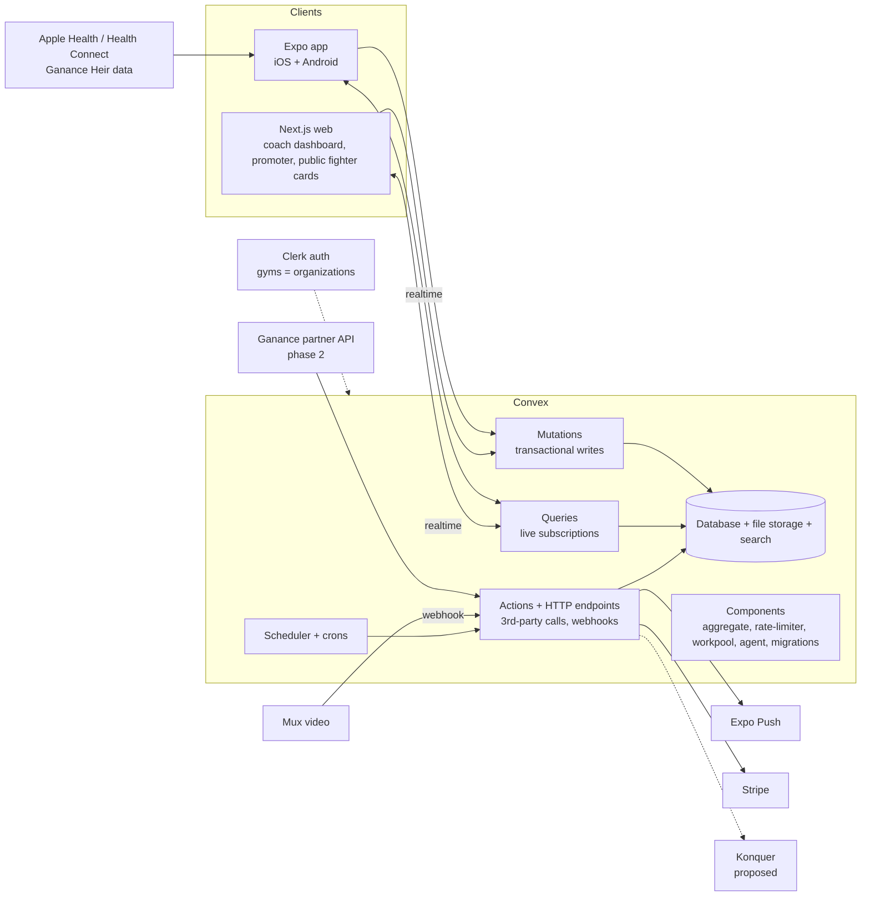

# BoxBit tech stack

Goal: one TypeScript codebase that ships an iOS/Android app and a web app, with **Convex as the single realtime source of truth**, so mobile, web and every AI agent working on the repo stay in sync.

## Architecture at a glance



## Each layer and what it does

### Monorepo: **Turborepo + pnpm workspaces**
```
apps/mobile      Expo (React Native) app
apps/web         Next.js app (App Router)
packages/backend Convex functions + schema  ← the contract
packages/ui      shared design tokens (colors, type, motion curves)
packages/shared  zod schemas, constants (weight classes, rules)
```
**Why:** one repo means one `convex/schema.ts`, and both apps import the generated types. When an agent changes the schema, TypeScript breaks every caller in mobile and web in the same PR. This is the main mechanism that keeps agents in sync.

### Mobile: **Expo (SDK 54+) + React Native + Expo Router**
- One codebase for iOS and Android. Expo Router gives file-based navigation, native stacks, native tabs and form sheets.
- **EAS Build / Submit / Update** for store builds and over-the-air JS updates.
- **Dev builds** (not Expo Go), because HealthKit and Health Connect need native modules.
- Expo now ships a one-command Convex provisioning flow ([Expo blog](https://expo.dev/blog/convex-is-a-backend-for-expo-apps)).

### Web: **Next.js (App Router) on Vercel**
- Coach dashboard (big-screen roster, plan builder), promoter search, event admin.
- **Public fighter cards** are server-rendered so they're shareable and indexable. Satori generates dynamic OG images, so a card unfurls nicely in iMessage and Instagram DMs.

### Backend: **Convex**
Convex replaces a database, an API server, websockets, a job queue and file storage.
| Convex piece | What we use it for |
|---|---|
| **Schema + database** | Users, gyms, posts, sessions, metrics, events, bouts (see data model below). Typed end to end. |
| **Queries** | Every screen subscribes with `useQuery`. When a coach assigns a plan, the fighter's Train tab updates live; props counts tick in real time. No cache invalidation code. |
| **Mutations** | Transactional writes (post, react, register, change privacy). Optimistic updates for snappy UI. |
| **Actions** | Calls to outside services: Mux uploads, Stripe, push notifications, AI moderation, Ganance API. |
| **HTTP actions** | Webhook endpoints (Mux "video ready", Stripe, Ganance data push, Clerk user sync). |
| **Scheduler + crons** | Nightly wearable rollups, streak and milestone detection, "Fight Camp ends" auto-unhide, reminders at 5:30am. |
| **File storage** | Avatars, documents (physicals, proof of age; access-restricted). Video goes to Mux. |
| **Search** | Promoter discovery (name, gym, city) plus indexed filters (division, region, record). |
| **Components** | `@convex-dev/aggregate` (leaderboards, team totals), `rate-limiter` (spam), `workpool` (fan-out notifications), `migrations` (safe schema changes), `agent` (in-app AI coach assistant later). |
| **Preview deployments** | Every PR/branch gets its own Convex backend, so agents can test against isolated data. |

**Privacy is enforced in Convex, never in the UI.** Every read that returns fighter data goes through one helper, e.g. `canView(viewer, owner, field)`, built with `convex-helpers` custom functions (row-level-security pattern). The client can't fetch what it isn't allowed to see. Fight Camp mode is just a flag that this helper checks.

### Auth: **Clerk** (with Convex's Clerk integration)
- Organizations map to **gyms**; org roles map to **head coach / coach / fighter**. Promoters are verified accounts.
- Works natively in Expo and Next.js. Supports parent/guardian accounts for youth (Convex Auth is the lighter alternative if you want fewer vendors).

### Wearables: **Ganance Heir → Apple Health / Health Connect → Convex**
- **Phase 1 (no partnership needed):** the Heir already syncs steps, distance, calories and cadence to the Ganance app and Apple Health. We read them with `@kingstinct/react-native-healthkit` (iOS) and `react-native-health-connect` (Android), then batch-write daily summaries to Convex.
- **Phase 2:** a direct Ganance API or webhook into a Convex HTTP action: real-time, works for users without phones in the room, and supports school bulk deployments (OUSD) where devices are managed by the coach.
- **Optional:** an aggregator such as Terra or Junction for Garmin, Whoop, Fitbit and Oura without building each integration.

### Video: **Mux**
Direct uploads from the phone, automatic transcoding, HLS streaming, thumbnails and short clip trimming. A Mux webhook tells Convex the clip is ready, and the post goes live. (Cloudflare Stream is the budget alternative.)

### Motion, gamification and UI
| Concern | Mobile | Web |
|---|---|---|
| Animation | Reanimated 4 + Gesture Handler (UI-thread animation) | `motion` + CSS transitions |
| Haptics | `expo-haptics` (bell, round end, props) | — |
| Styling | NativeWind (Tailwind for RN), tokens from `packages/ui` | Tailwind + `cva` + `clsx` |
| Primitives | Expo Router native sheets, native tabs, `Link.Menu` | Base UI |
| Toasts | `sonner-native` | Sonner |
| Charts | Victory Native (Skia) | Recharts |
| Animated coach | **Rive** (state-machine character: run, cheer, call combos), with Skia for the arcade strip | Rive web runtime |
| Number tickers | Reanimated text | NumberFlow |

All motion follows the vendored **Emil Kowalski skills** in `.claude/skills/` (see `CLAUDE.md`).

### Notifications: **Expo Push** (sent from Convex actions through a workpool)
### Payments: **Stripe** (event entry fees, gym/promoter subscriptions; Stripe Connect if gyms collect money)
### AI: **Claude** via Convex actions
Comment positivity moderation (Haiku 4.5), weekly training summaries for coaches, and "explain my stats" for fighters. The Convex Agent component handles thread memory.
### Quality and ops
- **Testing:** Vitest + `convex-test` (backend logic, privacy rules), Maestro (mobile E2E), Playwright (web).
- **Observability:** Sentry (crashes), PostHog (product analytics and feature flags).
- **CI/CD:** GitHub Actions runs typecheck, lint and tests, then deploys a Convex preview, then an EAS Update preview and a Vercel preview.

## Core data model (first cut)

| Table | Key fields |
|---|---|
| `users` | clerkId, name, role(s), birthYear, guardianId? |
| `gyms` | clerkOrgId, name, city, usaBoxingClubId |
| `memberships` | userId, gymId, role (headCoach/coach/fighter) |
| `fighterProfiles` | userId, nickname, division, stance, record {w,l,rsc}, titles, fightCampUntil? |
| `privacySettings` | userId, training, stats, weight, video ∈ {public, team, coaches} |
| `posts` | authorId, gymId, type, text, visibility, sessionId?, muxAssetId?, status (pending/approved) |
| `reactions` / `comments` | postId, userId, (text, moderation) |
| `plans` / `planRounds` | gymId, coachId, title, rounds[], assignedTo |
| `sessions` | userId, planId?, startedAt, rounds, durationSec, metricsSnapshot |
| `metricsDaily` | userId, date, steps, distanceM, activeKcal, cadenceAvg, source (healthkit/ganance) |
| `weighIns` | userId, date, kg, visibility |
| `events` / `registrations` / `bouts` | sanctioning, date, divisions / fighterId, status / red, blue, result |
| `shortlists` | promoterId, fighterId |
| `devices` | userId?, gymId?, vendor, serial, lastSyncAt |

## Agent orchestration: how agents build and maintain this without drifting

1. **One contract:** `packages/backend/convex/schema.ts` plus function signatures. Clients only talk to Convex through generated `api.*` types. There are no hand-written REST endpoints to drift.
2. **Agent lanes** (one owner per lane, defined in `CLAUDE.md`):
   - *Architect/planner:* turns features into GitHub issues with acceptance criteria; owns `docs/decisions/` (ADRs).
   - *Backend agent:* the only lane allowed to change the schema; must add a migration and `convex-test` coverage, privacy tests included.
   - *Mobile agent* / *Web agent:* consume the API and never touch the schema.
   - *Design QA agent:* runs the `review-animations`, `break-ui` and `mobile-native` skills on every UI PR.
   - *Test/review agent:* runs CI, reviews diffs, blocks merges that skip privacy checks.
3. **Sync mechanics:** shared types fail the build on mismatch, Convex preview deployments are isolated per branch, small PRs, and CI is the referee. A schema change PR merges before the UI PRs that depend on it.
4. **Memory:** `CLAUDE.md` (rules), `docs/` (product, stack, research, ADRs) and GitHub issues (task board) are the shared memory every agent reads first.

## Phased roadmap

| Phase | Scope |
|---|---|
| 0. Prototype (done) | Clickable mockup in `mockup/` |
| 1. MVP (8–10 wks) | Auth + gyms, Corner feed, privacy + Fight Camp, Train timer, HealthKit/Health Connect, fighter card, coach roster |
| 2 | Video highlights (Mux), animated coach (Rive), milestones/streaks, promoter discovery, web dashboard |
| 3 | Events + Konquer integration, Stripe, Ganance direct API, bulk device orders, AI summaries |
